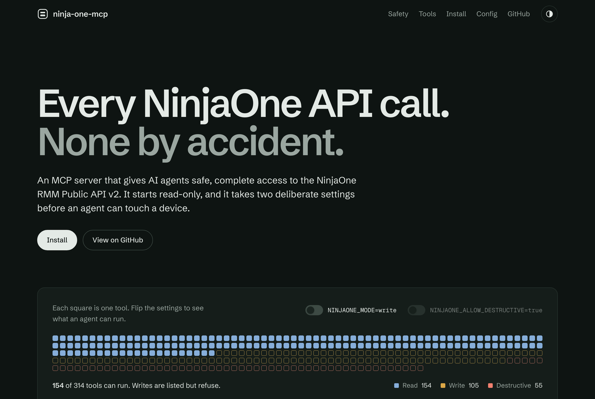

<div align="center">


# NinjaOne MCP server

**Every NinjaOne API call. None by accident.**

An MCP server that gives AI agents safe, complete access to the NinjaOne RMM Public API v2. Read only by default, with two gates for anything that changes a device.

[Website](https://divergeitamplifyai.github.io/ninja-one-mcp/) · [Tool catalog](docs/TOOLS.md) · [Deploy to Azure](docs/deploy-azure.md) · [Deploy to Cloudflare](docs/deploy-cloudflare.md) · [API coverage](docs/api-coverage.md) · [Design](docs/DESIGN.md) · [NinjaOne docs index](llms.txt)

[](https://github.com/divergeitamplifyai/ninja-one-mcp/actions/workflows/ci.yml)
[](LICENSE)


</div>

<p align="center">
  <a href="https://divergeitamplifyai.github.io/ninja-one-mcp/">
    <picture>
      <source media="(prefers-color-scheme: dark)" srcset="docs/assets/site-dark.png">
      
    </picture>
  </a>
</p>

## What it does

For MSPs and IT teams that run many client organizations in NinjaOne. All 315 operations in NinjaOne's Public API v2 are reachable: 302 through typed tools and 13 multipart or UI-config endpoints through a gated raw passthrough, and a CI check maps every spec operation to its tool. Agents triage the fleet, profile devices, report on patches and alerts, work tickets and documentation, and, once you open the gates, make changes with dry runs and read-back. It never requests secure custom field values, never infers an organization, and never replays an action.

Ask things like:

> Which clients have the most offline servers right now?
>
> Give me a full profile of device 1042: disks, patches, alerts.
>
> Summarize failed OS patches for Example Org this week, grouped by KB.
>
> Put HOST-1042 in maintenance tonight from 22:00 to 02:00, then reboot it. *(needs write mode, then both gates)*

## Install

Every lane runs the same server and reads the same settings (see [Configuration](#configuration)). You need a NinjaOne API client first: see [Create the API client](#create-the-api-client).

### Local (stdio)

Requires Node 22 or later. Any MCP client that runs stdio servers can start it straight from GitHub:

```json
{
  "mcpServers": {
    "ninjaone": {
      "command": "npx",
      "args": ["-y", "github:divergeitamplifyai/ninja-one-mcp"],
      "env": {
        "NINJAONE_CLIENT_ID": "<from your secret manager>",
        "NINJAONE_CLIENT_SECRET": "<from your secret manager>",
        "NINJAONE_REGION": "us",
        "NINJAONE_MODE": "read"
      }
    }
  }
}
```

Or from a checkout: `npm ci && npm run build`, then `"command": "node", "args": ["/absolute/path/to/ninja-one-mcp/dist/index.js"]`.

<details>
<summary><b>Codex</b></summary>

```bash
codex mcp add ninjaone --env NINJAONE_CLIENT_ID=your-id --env NINJAONE_CLIENT_SECRET=your-secret --env NINJAONE_REGION=us -- npx -y github:divergeitamplifyai/ninja-one-mcp
```

Or install the plugin, then put the credentials in the [credentials file](#credentials-file):

```bash
codex plugin marketplace add divergeitamplifyai/ninja-one-mcp
```
</details>

<details>
<summary><b>Cursor</b></summary>

[Add to Cursor](https://cursor.com/en/install-mcp?name=ninjaone&config=eyJjb21tYW5kIjoibnB4IiwiYXJncyI6WyIteSIsImdpdGh1YjpkaXZlcmdlaXRhbXBsaWZ5YWkvbmluamEtb25lLW1jcCJdLCJlbnYiOnsiTklOSkFPTkVfQ0xJRU5UX0lEIjoieW91ci1pZCIsIk5JTkpBT05FX0NMSUVOVF9TRUNSRVQiOiJ5b3VyLXNlY3JldCIsIk5JTkpBT05FX1JFR0lPTiI6InVzIiwiTklOSkFPTkVfVE9PTFNFVFMiOiJjb3JlLGRldmljZXMsYWxlcnRzIn19), then replace the placeholders, or put the JSON above in `.cursor/mcp.json` with `"NINJAONE_TOOLSETS": "core,devices,alerts"`. Cursor works best with a small toolset.
</details>

<details>
<summary><b>VS Code with GitHub Copilot</b></summary>

[Install in VS Code](https://vscode.dev/redirect/mcp/install?name=ninjaone&config=%7B%22name%22%3A%22ninjaone%22%2C%22command%22%3A%22npx%22%2C%22args%22%3A%5B%22-y%22%2C%22github%3Adivergeitamplifyai%2Fninja-one-mcp%22%5D%2C%22env%22%3A%7B%22NINJAONE_CLIENT_ID%22%3A%22%24%7Binput%3Aninjaone_client_id%7D%22%2C%22NINJAONE_CLIENT_SECRET%22%3A%22%24%7Binput%3Aninjaone_client_secret%7D%22%2C%22NINJAONE_REGION%22%3A%22us%22%7D%2C%22inputs%22%3A%5B%7B%22type%22%3A%22promptString%22%2C%22id%22%3A%22ninjaone_client_id%22%2C%22description%22%3A%22NinjaOne%20client%20id%22%7D%2C%7B%22type%22%3A%22promptString%22%2C%22id%22%3A%22ninjaone_client_secret%22%2C%22description%22%3A%22NinjaOne%20client%20secret%22%2C%22password%22%3Atrue%7D%5D%7D), or add `.vscode/mcp.json`. VS Code prompts for the secret and stores it securely:

```json
{
  "inputs": [
    { "type": "promptString", "id": "ninjaone_client_id", "description": "NinjaOne client id" },
    { "type": "promptString", "id": "ninjaone_client_secret", "description": "NinjaOne client secret", "password": true }
  ],
  "servers": {
    "ninjaone": {
      "type": "stdio",
      "command": "npx",
      "args": ["-y", "github:divergeitamplifyai/ninja-one-mcp"],
      "env": {
        "NINJAONE_CLIENT_ID": "${input:ninjaone_client_id}",
        "NINJAONE_CLIENT_SECRET": "${input:ninjaone_client_secret}",
        "NINJAONE_REGION": "us"
      }
    }
  }
}
```

Copilot sends at most 128 tools per request. The default toolsets list 108.
</details>

### Claude Desktop (.mcpb)

Download `ninja-one-mcp.mcpb` from the [latest release](https://github.com/divergeitamplifyai/ninja-one-mcp/releases/latest) and open it. Fill in the fields under Settings > Extensions. The client secret is stored by Claude Desktop, not in a file, and never shown to the model. Mode defaults to `read`.

### Claude Code plugin

```bash
claude plugin marketplace add divergeitamplifyai/ninja-one-mcp
claude plugin install ninjaone@ninja-one-mcp
```

Claude Code asks for the client id, secret, region, mode and toolsets, and keeps the secret in your system keychain. The plugin also adds four skills: working with NinjaOne, setup, fleet triage and patch review. To add only the server:

```bash
claude mcp add ninjaone -e NINJAONE_CLIENT_ID=your-id -e NINJAONE_CLIENT_SECRET=your-secret -e NINJAONE_REGION=us -- npx -y github:divergeitamplifyai/ninja-one-mcp
```

### Create the API client

In NinjaOne, go to **Administration > Apps > API > Client App IDs > Add**:

- **Application platform**: API Services (machine-to-machine)
- **Allowed grant types**: Client Credentials
- **Scopes**: `monitoring` to read, `management` to make changes, `control` to run scripts and remote actions. Grant only what you need. The server asks for `monitoring` unless `NINJAONE_SCOPES` says more.

The client lives in one regional instance, the one you sign in to: `us` (app.ninjarmm.com), `us2`, `eu`, `ca` or `oc`. Then ask your agent to run `ninjaone_test_connection`.

## Configuration

Every variable, from [.env.example](.env.example). With nothing set the server still starts; `ninjaone_status_server` says what is missing. Typos fail closed.

| Variable | Required | Default | Meaning |
|---|---|---|---|
| `NINJAONE_CLIENT_ID` | yes | | API client id. |
| `NINJAONE_CLIENT_SECRET` | yes | | API client secret. Never logged or returned. |
| `NINJAONE_REGION` | yes, unless `NINJAONE_BASE_URL` | | `us`, `us2`, `eu`, `ca` or `oc`. No default: a wrong guess sends the credential to the wrong instance. |
| `NINJAONE_BASE_URL` | no | | Instance origin. Overrides the region. https only. |
| `NINJAONE_SCOPES` | no | `monitoring` | OAuth scopes to request: `monitoring`, `management`, `control`. |
| `NINJAONE_ORG_ID` | no | | Default organization when a call omits `org`. The argument always wins. |
| `NINJAONE_ALLOWED_ORG_IDS` | no | | Hard boundary: comma-separated organization ids. |
| `NINJAONE_MODE` | no | `read` | `write` enables the write tier. |
| `NINJAONE_ALLOW_DESTRUCTIVE` | no | `false` | `true` also enables the destructive tier. Needs write mode. |
| `NINJAONE_WRITE_ALLOWLIST` | no | | Comma-separated write tool names. Every other write refuses. |
| `NINJAONE_TOOLSETS` | no | `default` | Which toolsets to list (see [Tools](#tools)). |
| `NINJAONE_MAX_CONCURRENCY` | no | `4` | Fan-out cap for cross-organization reads, 1 to 16. |
| `NINJAONE_ENV_FILE` | no | `~/.config/ninja-one-mcp/.env` | Credentials file path, or `none`. stdio only. |

Remote hosting adds the `MCP_*` transport settings in [LANES.md](LANES.md#3-environment-variables).

### Credentials file

Some hosts start MCP servers with a filtered environment. For those, put `KEY=VALUE` lines in `~/.config/ninja-one-mcp/.env`:

```bash
mkdir -p ~/.config/ninja-one-mcp
printf 'NINJAONE_CLIENT_ID=...\nNINJAONE_CLIENT_SECRET=...\nNINJAONE_REGION=us\n' > ~/.config/ninja-one-mcp/.env
chmod 600 ~/.config/ninja-one-mcp/.env
```

Only `NINJAONE_*` keys are read, the environment always wins over the file, and the file is ignored if other users can read it.

## Safety model

```text
                       NINJAONE_MODE=write      NINJAONE_ALLOW_DESTRUCTIVE=true
 read    154 tools  ------------ always ---------------------------------------->
 write   105 tools  --- refused ---| runs, with confirm: true ------------------>
 destr.   56 tools  --- refused -------------- refused ---| runs, confirm: true >
```

- **Read only by default.** Write tools are listed but refuse until `NINJAONE_MODE=write`. The destructive tier (deletes, reboots, scripts, patch installs, full replacements, secret-bearing downloads and raw writes) also needs `NINJAONE_ALLOW_DESTRUCTIVE=true`. A refused tool names the setting and sends nothing.
- **Every write takes `confirm: true`**, on the call itself. Writes that touch many records return the exact request until `dry_run: false`, and writes read back and return `before` and `after`.
- **No guessed tenants.** Organization tools take `org` (an id or a unique part of the name); ambiguous names are refused with the candidates. `NINJAONE_ALLOWED_ORG_IDS` is a hard boundary: device filters are narrowed, device ids and rows are checked, and tools that cannot be scoped refuse, including the raw passthrough.
- **No credential in the transcript.** Credentials come from the environment, travel in a form body and a bearer header, never a query string, and are redacted from results, errors and logs. Secure custom field values are never requested; signed URLs come only from destructive-tier `download_*` tools with `reveal: true`.
- **Actions are never replayed.** Scripts, reboots, patch installs and service control are never retried, not even on 429. Every error ends with a `Next step:` line.
- **The real boundary is the credential.** The gates bind this server only; grant the API client only the scopes it needs. `monitoring` alone makes every write impossible.

`mutations.json` records each tool's blast radius and rollback.

## Tools

315 tools: 151 read, 3 interactive views, 105 write, 56 destructive. The default toolsets list 108 (78 read and views, 19 write, 11 destructive). Every tool, with its kind, is in [docs/TOOLS.md](docs/TOOLS.md).

### Diagnostics (3)

| Tool | Kind | Does |
|---|---|---|
| `ninjaone_status_server` | read | Configuration and missing settings, no API call. |
| `ninjaone_status_gate` | read | Gate state and the settings that change it. |
| `ninjaone_test_connection` | read | One token request and one cheap authenticated call. |

### Toolsets (315)

`NINJAONE_TOOLSETS` picks what is listed: `all`, `default`, or a list such as `default,billing`. Toolsets only decide listing; annotations and gates never change with them.

| Toolset | Tools | Covers |
|---|---:|---|
| `core` | 14 | Diagnostics, organizations, locations, find, fleet health. Always on. |
| `devices` | 27 | Device lists, search, profile, hardware, software, services, custom field values. |
| `alerts` | 7 | Alerts, activities, jobs. |
| `reports` | 23 | Fleet-wide `/v2/queries` reports: inventory, patches, antivirus, health, custom fields. |
| `actions` | 20 | Reboot, scripts, services, patch scan and apply, maintenance, approval. |
| `ticketing` | 14 | Tickets, boards, forms, comments, ticket contacts. |
| `views` | 3 | Interactive MCP Apps views: fleet, device, alerts. |
| `policies` | 16 | Policies, conditions, device roles, groups, script library, scheduled tasks. |
| `documentation` | 57 | Documents, templates, checklists, knowledge base. |
| `assets` | 40 | Asset tags, software licenses, relationships, related items, unmanaged devices. |
| `custom_fields` | 11 | Custom field definitions and global values. |
| `users` | 24 | Contacts, end users, technicians, roles. |
| `billing` | 31 | Accounts, agreements, invoices, products, ticket products. |
| `backup` | 8 | Backup jobs and usage, integrity checks, vulnerability scan groups. |
| `admin` | 18 | Webhook, notification channels, custom tabs, node roles, installers. |
| `api` | 2 | `ninjaone_api_get` (read) and `ninjaone_api_write` (destructive). |

The first seven are the default.

### Highlights

| Tool | Kind | Does |
|---|---|---|
| `ninjaone_report_fleet_health` | read | Every client in one call: devices, offline, health, pending and failed patches, alerts, AV threats. A failing client gets its own error row. |
| `ninjaone_get_device_profile` | read | Device record, last user, volumes, disks, CPUs, NICs, alerts and patch counts in one call. |
| `ninjaone_view_fleet`, `ninjaone_view_device`, `ninjaone_view_alerts` | read (view) | Interactive views where the host renders MCP Apps; JSON elsewhere. The Reset button calls the same gated tool the model would. |
| `ninjaone_reset_alert` | write | Reset one alert. |
| `ninjaone_api_write` | destructive | Raw POST, PUT, PATCH or DELETE for endpoints without a typed tool. |

Resources: `ninjaone://docs/llms.txt` (NinjaOne's public docs index) and `ninjaone://docs/device-filters` (the `df` syntax). Prompts: `fleet_triage`, `patch_review`, `device_triage`, `setup_check`.

## Remote hosting

The same server runs as a shared remote MCP endpoint, read only by default:

- **Azure Container Apps**, Entra ID sign-in, NinjaOne client id and secret in Key Vault: [docs/deploy-azure.md](docs/deploy-azure.md).
- **Cloudflare Workers**, Cloudflare Access or a bearer token: [docs/deploy-cloudflare.md](docs/deploy-cloudflare.md).

Every caller acts as the deployment's one NinjaOne API client, so use a `monitoring`-only client and `NINJAONE_ALLOWED_ORG_IDS` where you can. Both deploy workflows are manual and off until `DEPLOY_AZURE_ENABLED` or `DEPLOY_CLOUDFLARE_ENABLED` is set. Lane rules: [LANES.md](LANES.md).

## Development

```bash
npm ci
npm run check          # typecheck, generated-file drift, tests, conformance, coverage, catalog, bundle, lane checks
npm run gen            # regenerate the docs index, body docs, views runtime, catalog, coverage and plugin bundle
npm run start:http     # local Streamable HTTP on 127.0.0.1:8080 (set MCP_HTTP_AUTH)
npm run pack:mcpb      # build/ninja-one-mcp.mcpb
```

Tests use `node:test` against loopback mocks only. The NinjaOne mock reproduces the API's dangerous behaviors, such as a policy PUT that replaces everything and a POST that fails after it may have applied, so a tool that would cause damage fails a test, not a tenant. Each tool is declared once as a route and goes through one engine (gate, scope, request, `before`, dry run, send, `after`, shape); [docs/DESIGN.md](docs/DESIGN.md) explains the decisions.

Standard and review checklist: [STANDARD.md](STANDARD.md), [CHECKLIST.md](CHECKLIST.md). Agent instructions: [AGENTS.md](AGENTS.md). Contributing: [CONTRIBUTING.md](CONTRIBUTING.md).

## Security

Report vulnerabilities privately through GitHub's [private vulnerability reporting](https://github.com/divergeitamplifyai/ninja-one-mcp/security/advisories/new), as described in [SECURITY.md](SECURITY.md). Never include credentials, tenant ids or client data in an issue.

## License

[MIT](LICENSE), 2026 Patrick King.

NinjaOne also runs its own hosted MCP server ([Katana AI](https://www.ninjaone.com/docs/ticketing/katana-ai-getting-started-with-the-model-context-protocol/)). This project is independent and open source. It is not affiliated with or endorsed by NinjaOne. NinjaOne is a trademark of its owner.
