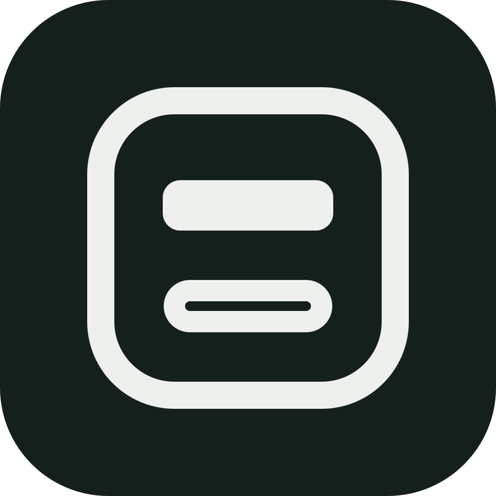

<div align="center">



# ninja-one-mcp

**Every NinjaOne API call. None by accident.**

An MCP server that gives AI agents safe, complete access to the NinjaOne RMM Public API v2.<br>
Read-only by default. Two gates for anything that changes a device.

[Website](https://patrickking67.github.io/ninja-one-mcp/) · [Tool catalog](docs/TOOLS.md) · [API coverage](docs/api-coverage.md) · [Design](docs/DESIGN.md) · [NinjaOne docs index](llms.txt)

[](https://github.com/patrickking67/ninja-one-mcp/actions/workflows/ci.yml)
[](LICENSE)


</div>

<p align="center">
  <a href="https://patrickking67.github.io/ninja-one-mcp/">
    <picture>
      <source media="(prefers-color-scheme: dark)" srcset="docs/assets/site-dark.png">
      
    </picture>
  </a>
</p>

---

| | |
|---|---|
| **Complete** | All 315 operations in NinjaOne's Public API v2 are covered. 302 have typed tools and 13 multipart or UI-config endpoints go through a gated passthrough. A CI check maps every operation in the spec to its tool. |
| **Safe by construction** | Read-only until you say otherwise. Destructive actions need a second switch, and every change needs `confirm: true`. Wide changes are dry runs first. Writes return `before` and `after`. |
| **Built for many clients** | Organizations resolve by id or name, ambiguity is refused, and nothing is inferred. An optional boundary holds every call inside the clients you list. |
| **Agent-shaped** | Compact, paged results. Composed workflows instead of 15 round trips. Every error ends with a `Next step:` line. Interactive views where the host supports MCP Apps. |
| **Everywhere** | Claude Code, Claude Desktop, Codex, Cursor, VS Code with Copilot, and any MCP client that runs stdio servers. |

## What you can ask

> Which clients have the most offline servers right now?
>
> Give me a full profile of device 1042: disks, patches, alerts.
>
> Summarize failed OS patches for Example Org this week, grouped by KB.
>
> Which devices still run an old version of the VPN client?
>
> Put HOST-1042 in maintenance tonight from 22:00 to 02:00, then reboot it. *(needs write mode, then both gates)*

## Install

You need a NinjaOne API client first (see [Create the API client](#create-the-api-client)). Then pick your client.

<details open>
<summary><b>Claude Code</b>: plugin, with skills and a keychain-stored secret</summary>

```bash
/plugin marketplace add patrickking67/ninja-one-mcp
/plugin install ninjaone@ninja-one-mcp
```

Claude Code asks for the client id, secret, region, mode and toolsets. The secret is kept in your system keychain. The plugin also adds four skills: working with NinjaOne, setup, fleet triage and patch review.

Or add just the server:

```bash
claude mcp add ninjaone -e NINJAONE_CLIENT_ID=your-id -e NINJAONE_CLIENT_SECRET=your-secret -e NINJAONE_REGION=us -- npx -y github:patrickking67/ninja-one-mcp
```
</details>

<details>
<summary><b>Claude Desktop</b>: one-click bundle</summary>

Download `ninja-one-mcp.mcpb` from the [latest release](https://github.com/patrickking67/ninja-one-mcp/releases/latest) and open it. Claude Desktop asks for the credentials and keeps the secret out of the model's view.
</details>

<details>
<summary><b>Codex</b></summary>

```bash
codex mcp add ninjaone --env NINJAONE_CLIENT_ID=your-id --env NINJAONE_CLIENT_SECRET=your-secret --env NINJAONE_REGION=us -- npx -y github:patrickking67/ninja-one-mcp
```

Or install the plugin, then put the credentials in the [credentials file](#credentials-file):

```bash
codex plugin marketplace add patrickking67/ninja-one-mcp
```
</details>

<details>
<summary><b>Cursor</b></summary>

[Add to Cursor](https://cursor.com/en/install-mcp?name=ninjaone&config=eyJjb21tYW5kIjoibnB4IiwiYXJncyI6WyIteSIsImdpdGh1YjpwYXRyaWNra2luZzY3L25pbmphLW9uZS1tY3AiXSwiZW52Ijp7Ik5JTkpBT05FX0NMSUVOVF9JRCI6InlvdXItaWQiLCJOSU5KQU9ORV9DTElFTlRfU0VDUkVUIjoieW91ci1zZWNyZXQiLCJOSU5KQU9ORV9SRUdJT04iOiJ1cyIsIk5JTkpBT05FX1RPT0xTRVRTIjoiY29yZSxkZXZpY2VzLGFsZXJ0cyJ9fQ==), then replace the placeholders. Or add it to `.cursor/mcp.json` yourself:

```json
{
  "mcpServers": {
    "ninjaone": {
      "command": "npx",
      "args": ["-y", "github:patrickking67/ninja-one-mcp"],
      "env": {
        "NINJAONE_CLIENT_ID": "your-id",
        "NINJAONE_CLIENT_SECRET": "your-secret",
        "NINJAONE_REGION": "us",
        "NINJAONE_TOOLSETS": "core,devices,alerts"
      }
    }
  }
}
```

Cursor works best with a small toolset.
</details>

<details>
<summary><b>VS Code with GitHub Copilot</b></summary>

[Install in VS Code](https://vscode.dev/redirect/mcp/install?name=ninjaone&config=%7B%22name%22%3A%22ninjaone%22%2C%22command%22%3A%22npx%22%2C%22args%22%3A%5B%22-y%22%2C%22github%3Apatrickking67%2Fninja-one-mcp%22%5D%2C%22env%22%3A%7B%22NINJAONE_CLIENT_ID%22%3A%22%24%7Binput%3Aninjaone_client_id%7D%22%2C%22NINJAONE_CLIENT_SECRET%22%3A%22%24%7Binput%3Aninjaone_client_secret%7D%22%2C%22NINJAONE_REGION%22%3A%22us%22%7D%2C%22inputs%22%3A%5B%7B%22type%22%3A%22promptString%22%2C%22id%22%3A%22ninjaone_client_id%22%2C%22description%22%3A%22NinjaOne%20client%20id%22%7D%2C%7B%22type%22%3A%22promptString%22%2C%22id%22%3A%22ninjaone_client_secret%22%2C%22description%22%3A%22NinjaOne%20client%20secret%22%2C%22password%22%3Atrue%7D%5D%7D), or add `.vscode/mcp.json`. VS Code prompts for the secret and stores it securely:

```json
{
  "inputs": [
    { "type": "promptString", "id": "ninjaone_client_id", "description": "NinjaOne client id" },
    { "type": "promptString", "id": "ninjaone_client_secret", "description": "NinjaOne client secret", "password": true }
  ],
  "servers": {
    "ninjaone": {
      "type": "stdio",
      "command": "npx",
      "args": ["-y", "github:patrickking67/ninja-one-mcp"],
      "env": {
        "NINJAONE_CLIENT_ID": "${input:ninjaone_client_id}",
        "NINJAONE_CLIENT_SECRET": "${input:ninjaone_client_secret}",
        "NINJAONE_REGION": "us"
      }
    }
  }
}
```

Copilot sends at most 128 tools per request. The default toolsets list 107.
</details>

<details>
<summary><b>Any other MCP client</b></summary>

Run `npx -y github:patrickking67/ninja-one-mcp` as a stdio server, with `NINJAONE_CLIENT_ID`, `NINJAONE_CLIENT_SECRET` and `NINJAONE_REGION` in its environment. You can also use the [credentials file](#credentials-file).
</details>

### Create the API client

In NinjaOne, go to **Administration > Apps > API > Client App IDs > Add**:

- **Application platform**: API Services (machine-to-machine)
- **Allowed grant types**: Client Credentials
- **Scopes**: `monitoring` to read, `management` to make changes, `control` to run scripts and remote actions. Grant only what you need. The server asks for `monitoring` unless `NINJAONE_SCOPES` says more.

The client lives in one regional instance, the one you sign in to: `us` (app.ninjarmm.com), `us2`, `eu`, `ca` or `oc`.

Then ask your agent to run `ninjaone_test_connection`.

## The safety model

```text
                       NINJAONE_MODE=write      NINJAONE_ALLOW_DESTRUCTIVE=true
 read    154 tools  ──────────── always ──────────────────────────────────────▶
 write   105 tools  ─── refused ───┤ runs, with confirm: true ─────────────────▶
 destr.   55 tools  ─── refused ───────────── refused ───┤ runs, confirm: true ▶
```

1. **Two gates, set by the operator, never by the model.** Writes need `NINJAONE_MODE=write`. The destructive tier needs `NINJAONE_ALLOW_DESTRUCTIVE=true` as well. That tier covers deletes, reboots, scripts, patch installs, full replacements, secret-bearing downloads and raw writes. A refused tool names the setting and sends nothing. `NINJAONE_WRITE_ALLOWLIST` can narrow writes to a short list.
2. **`confirm: true` on every change.** The gates are a standing decision. `confirm` is the model stating that it means this specific call.
3. **Dry runs and undo.** Writes that touch many records, such as policy mappings, bulk archive and delete, and device approval, return the exact request without sending it until `dry_run: false`. Writes read back and return `before` and `after`.
4. **The organization boundary.** `NINJAONE_ALLOWED_ORG_IDS=12,15` holds every call inside those clients:
   - Device filters get ` AND org in (12,15)` appended. NinjaOne filters only combine with AND, so this can only narrow.
   - Device ids are checked against the boundary.
   - Rows are re-checked.
   - Tools that cannot be scoped refuse, including the raw passthrough.
5. **Secrets stay put.**
   - Secure custom field values are never requested.
   - Signed and tokenized URLs (attachments, installers, exports) come only from destructive-tier `download_*` tools with `reveal: true`.
   - Credentials travel in a form body and a bearer header, never a query string, and are redacted from every result, error and log line.
   - Plaintext `http:` is refused off loopback.
6. **Actions are never replayed.** Scripts, reboots, patch installs and service control are never retried, not even on 429. A 5xx on any write is never replayed.
7. **Every error says what to do.** Failures are tool results whose last line starts with `Next step:` and names the argument, setting or tool that fixes them.

These gates bind this server. A credential held by an agent outside it is bound only by its NinjaOne scopes. Grant the API client the least it needs.

## Toolsets

About 300 tools is more than some clients accept. `NINJAONE_TOOLSETS` picks what is listed. Write `all` for everything, `default` for the default set, or a list such as `default,billing`.

| Toolset | Tools | Covers |
|---|---:|---|
| `core` | 14 | Diagnostics, organizations, locations, find, fleet health. Always on. |
| `devices` | 27 | Device lists, search, profile, hardware, software, services, custom field values. |
| `alerts` | 7 | Alerts, activities, jobs. |
| `reports` | 23 | Fleet-wide `/v2/queries` reports: inventory, patches, antivirus, health, custom fields. |
| `actions` | 20 | Reboot, scripts, services, patch scan and apply, maintenance, approval. |
| `ticketing` | 13 | Tickets, boards, forms, comments, ticket contacts. |
| `views` | 3 | Interactive MCP Apps views: fleet, device, alerts. |
| `policies` | 16 | Policies, conditions, device roles, groups, script library, scheduled tasks. |
| `documentation` | 57 | Documents, templates, checklists, knowledge base. |
| `assets` | 40 | Asset tags, software licenses, relationships, related items, unmanaged devices. |
| `custom_fields` | 11 | Custom field definitions and global values. |
| `users` | 24 | Contacts, end users, technicians, roles. |
| `billing` | 31 | Accounts, agreements, invoices, products, ticket products. |
| `backup` | 8 | Backup jobs and usage, integrity checks, vulnerability scan groups. |
| `admin` | 18 | Webhook, notification channels, custom tabs, node roles, installers. |
| `api` | 2 | `ninjaone_api_get` and `ninjaone_api_write`. |

The first seven are the default: 107 tools. See every tool in [docs/TOOLS.md](docs/TOOLS.md).

### Highlights

- `ninjaone_report_fleet_health`: every client in one call, with devices, offline, health, pending and failed patches, alerts and AV threats. It fans out under a concurrency cap. A client that fails gets its own error row and does not sink the answer.
- `ninjaone_get_device_profile`: the device record, last user, volumes, disks, CPUs, NICs, alerts and patch counts in one call. A failed part is reported, not fatal.
- `ninjaone_view_fleet`, `ninjaone_view_device`, `ninjaone_view_alerts`: interactive views in hosts that render MCP Apps. The Reset button calls the same gated tool the model would. Other hosts get the same data as JSON.
- 23 `ninjaone_report_*` tools over `/v2/queries`, cursor paged and narrowed with `df`.
- `ninjaone://docs/llms.txt` and `ninjaone://docs/device-filters`: NinjaOne's public docs index and the `df` syntax, served as MCP resources.

## Configuration

| Variable | Default | Meaning |
|---|---|---|
| `NINJAONE_CLIENT_ID` | (required) | API client id. |
| `NINJAONE_CLIENT_SECRET` | (required) | API client secret. Never logged or returned. |
| `NINJAONE_REGION` | (required) | `us`, `us2`, `eu`, `ca` or `oc`. There is no default, because a wrong guess sends your credential to the wrong instance. |
| `NINJAONE_BASE_URL` | | Instance origin. Overrides the region. Must be https. |
| `NINJAONE_SCOPES` | `monitoring` | OAuth scopes to request: `monitoring`, `management`, `control`. |
| `NINJAONE_MODE` | `read` | `write` enables the write tier. |
| `NINJAONE_ALLOW_DESTRUCTIVE` | `false` | `true` enables the destructive tier. Needs write mode. |
| `NINJAONE_WRITE_ALLOWLIST` | | Comma-separated write tool names. Every other write refuses. |
| `NINJAONE_ALLOWED_ORG_IDS` | | Comma-separated organization ids. A hard boundary on every call. |
| `NINJAONE_ORG_ID` | | Default organization when a call omits `org`. The argument always wins. |
| `NINJAONE_TOOLSETS` | `default` | Which toolsets to list. |
| `NINJAONE_MAX_CONCURRENCY` | `4` | Fan-out concurrency, 1 to 16. |
| `NINJAONE_ENV_FILE` | `~/.config/ninja-one-mcp/.env` | Credentials file path, or `none`. |

Typos fail closed. `ninjaone_status_server` reports every problem without calling the API.

### Credentials file

Some hosts start MCP servers with a filtered environment. For those, put `KEY=VALUE` lines in `~/.config/ninja-one-mcp/.env`:

```bash
mkdir -p ~/.config/ninja-one-mcp
printf 'NINJAONE_CLIENT_ID=...\nNINJAONE_CLIENT_SECRET=...\nNINJAONE_REGION=us\n' > ~/.config/ninja-one-mcp/.env
chmod 600 ~/.config/ninja-one-mcp/.env
```

- Only `NINJAONE_*` keys are read.
- The environment always wins over the file.
- The file is ignored if other users can read it.

## How it is built

```text
src/
  routes/          declarative route tables: one Route per endpoint (path, scope, paging, body, safety)
  engine.ts        turns every Route into a tool through one audited path
  tools/           composed workflows, views, passthrough, diagnostics, resources
  auth.ts          OAuth client credentials, token cache, single-flight refresh
  client.ts        HTTP, 401 refresh, 429 and GET-only 5xx retries, never-retry actions
  orgs.ts          organization directory, boundary, device checks, df narrowing
  gate.ts spec.ts  the two gates, confirm, annotations; defineTool is the only way to register
  toolsets.ts      listing groups for clients that cap tools
spec/              NinjaOne's OpenAPI spec, the source of truth for coverage and body docs
scripts/           conformance, coverage, catalog, body docs, bundle, .mcpb pack
plugins/ninjaone/  the NinjaOne plugin: Claude Code and Codex manifests, skills, bundled server
site/              the website (GitHub Pages)
```

Each tool is declared once as data. The engine applies the same order to every call:

1. Gate.
2. Scope.
3. Request.
4. `before`.
5. Dry run.
6. Send.
7. `after`.
8. Shape.

A safety rule is therefore written once, not 300 times. [docs/DESIGN.md](docs/DESIGN.md) explains the decisions.

## Develop

```bash
npm ci
npm run check      # typecheck, generated-file drift, 40 tests, 5,164 conformance checks, coverage, catalog, bundle
npm run gen        # regenerate body docs, views runtime, catalog, coverage and the plugin bundle
npm run pack:mcpb  # build/ninja-one-mcp.mcpb
```

The tests run the built server over real stdio against a loopback NinjaOne mock. The mock reproduces the API's dangerous behaviors, such as a policy PUT that replaces everything and a POST that 5xxs after it may have applied. A tool that would cause damage fails a test, not a tenant. Nothing leaves the machine.

See [CONTRIBUTING.md](CONTRIBUTING.md) and [AGENTS.md](AGENTS.md).

## Security

Report vulnerabilities privately through GitHub's [private vulnerability reporting](https://github.com/patrickking67/ninja-one-mcp/security/advisories/new). See [SECURITY.md](SECURITY.md).

## License

[MIT](LICENSE) © 2026 Patrick King.

NinjaOne also runs its own hosted MCP server ([Katana AI](https://www.ninjaone.com/docs/ticketing/katana-ai-getting-started-with-the-model-context-protocol/)), which is monitoring-only for now. This project is independent and open source. It is not affiliated with or endorsed by NinjaOne. NinjaOne is a trademark of its owner.
